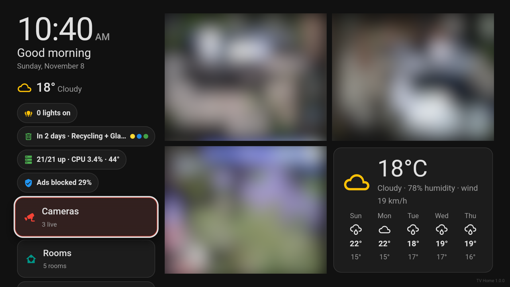
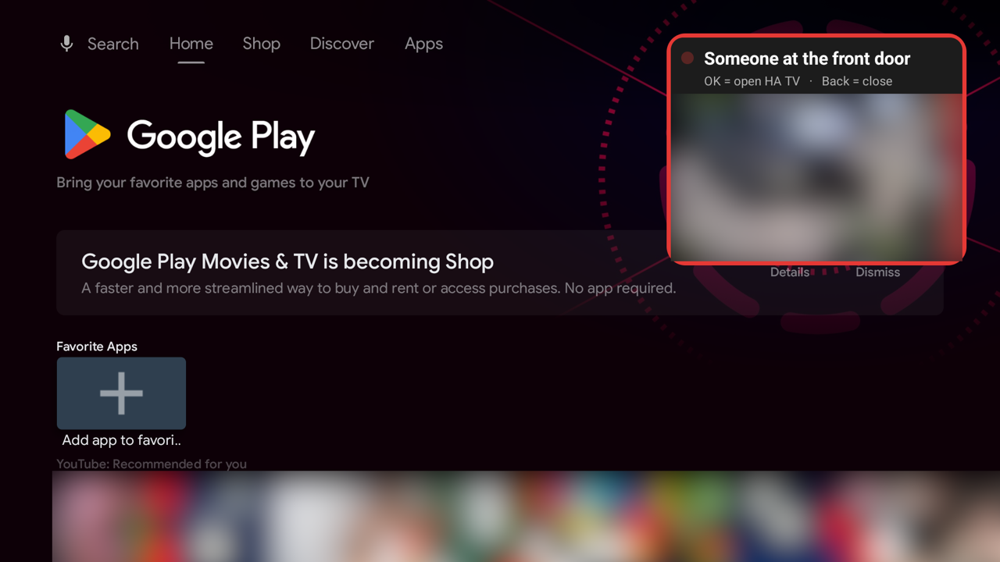
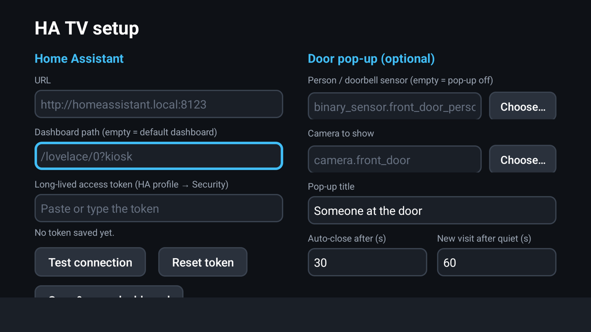
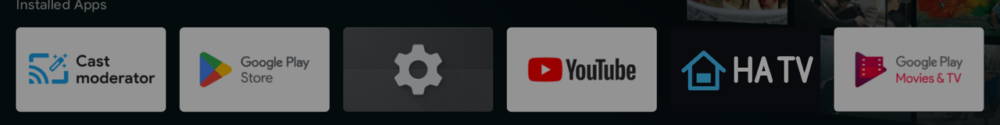

# HA TV

A small Android TV / Google TV app that shows a Home Assistant dashboard full screen and is
driven entirely by the TV remote, plus an optional "someone at the door" camera pop-up that
appears over whatever you are watching.

- No mouse cursor. D-pad and OK go straight to the page as arrow keys and Enter.
- Logs in with a long-lived access token, no HA login page.
- Back sends Escape to the page (closes pop-ups/full-screen views). Press Back twice to exit.
- Door pop-up: when a person/doorbell sensor turns on, a small live camera window shows in the
  top-right corner over Netflix, YouTube, live TV, anything. OK opens HA TV, Back closes it.
- LAN only. No Google Play services, no analytics, no ads. Only AndroidX + OkHttp.
- Nothing is hard-coded: URL, dashboard, sensor, camera, title and timings are set on the TV.

| Dashboard (camera feeds blurred) | Door pop-up over the Google TV home screen |
|---|---|
|  |  |

| Setup screen | In the Apps row |
|---|---|
|  |  |

Works with any dashboard. It works best with a dashboard built for a remote (one that handles
arrow keys/Enter/Escape itself) and HA's `?kiosk` mode, if you use the kiosk-mode card.

Want a ready-made one? [TV Home card](https://github.com/codemastervy/tv-home-card) is the
remote-first dashboard (cameras, rooms, lights) the screenshots above were taken with.

## Requirements

- Android TV / Google TV 8.0 (API 26) or newer.
- Home Assistant reachable from the TV (plain `http://` on the LAN is fine).
- A computer with `adb` to install the APK and grant the pop-up permission once.

## Install

1. On the TV: Settings → System → About → click "Android TV OS build" 7 times to enable
   Developer options. Then Settings → System → Developer options → turn on USB debugging /
   Network debugging (the name varies by TV). Note the TV's IP address.
2. On your computer:

       adb connect <TV-IP>:5555          # accept the prompt on the TV ("Always allow")
       adb install -r ha-tv.apk          # the APK from GitHub Releases
       adb shell appops set io.github.codemastervy.hatv SYSTEM_ALERT_WINDOW allow   # needed for the door pop-up
       adb shell appops write-settings                                   # save it now (survives a quick reboot)
       adb shell dumpsys deviceidle whitelist +io.github.codemastervy.hatv          # optional: don't let the TV kill it
       adb shell appops set io.github.codemastervy.hatv AUTO_START allow             # TCL TVs only: let it start after a reboot
       adb shell appops write-settings

3. Open HA TV from the Apps row on the TV.

## Set up (on the TV, with the remote)

In Home Assistant: your profile → Security → Long-lived access tokens → Create token.

On the HA TV setup screen:

| Field | Example | Notes |
|---|---|---|
| URL | `http://homeassistant.local:8123` | Your HA address as seen from the TV (often `http://<HA-IP>:8123`) |
| Dashboard path | `/lovelace/0?kiosk` | Empty = default dashboard |
| Token | (the long-lived token) | Stored encrypted; never shown again |
| Person / doorbell sensor | `binary_sensor.front_door_person` | Use **Choose…** to pick from a list. Empty = no pop-up |
| Camera to show | `camera.front_door` | Use **Choose…** |
| Pop-up title | Someone at the door | |
| Auto-close after (s) | 30 | 5-600 |
| New visit after quiet (s) | 60 | See "How the pop-up decides" |

Press **Test connection**, then **Save & open dashboard**.

Tips for the remote: arrows always move between fields; press OK on a field to type; the
keyboard's ✓ / Enter closes it.

Back to setup later: hold OK for 5 seconds on the dashboard, or press the remote's Menu/Settings key.

## How the pop-up decides

- One pop-up per visit. Person sensors flicker on/off every few seconds while someone stands at
  the door, so a visit only ends after the sensor has stayed off for the "quiet" time (default 60 s).
  Set it to 0 to show on every off→on.
- If the sensor is already on when the TV starts, no pop-up (no stale alerts).
- No pop-up while HA TV itself is on screen, or while the TV screen is off.
- The pop-up shows within about 0.2 s of the sensor turning on; the live picture follows as soon
  as Home Assistant delivers the first camera frame (usually around 1 s).

## Update

    adb connect <TV-IP>:5555
    adb install -r ha-tv.apk

Settings, token and the pop-up permission are kept.

## Reset the token / change settings

Hold OK 5 s on the dashboard (or press Menu) → **Reset token** (press twice to confirm).
Also revoke the token in HA (profile → Security) if the TV is leaving the house.

## Grant the pop-up permission again

If setup shows "Overlay permission missing" (e.g. after a factory reset or a reinstall after uninstalling):

    adb shell appops set io.github.codemastervy.hatv SYSTEM_ALERT_WINDOW allow
    adb shell appops write-settings

## Uninstall

TV: Settings → Apps → HA TV → Uninstall. Or: `adb uninstall io.github.codemastervy.hatv`.
Then revoke the token in Home Assistant.

## Build from source

Needs JDK 17 and the Android SDK (platform 34, build-tools 34).

    ./gradlew assembleDebug testDebugUnitTest
    # APK: app/build/outputs/apk/debug/app-debug.apk

Release build (what goes on GitHub Releases):

    ./gradlew assembleRelease
    # APK: app/build/outputs/apk/release/app-release.apk

Release signing reads a properties file that lives outside the repo and is never committed:
`~/.android-keys/hatv/signing.properties` (or `-Phatv.signing=/path/to/file`) with
`storeFile`, `storePassword`, `keyAlias`, `keyPassword`. Without it the release APK is signed
with the debug key (fine for your own TV, but it won't update over an official release; uninstall first).

Plain-HTTP policy: by default the app may use plain `http://` to any host, because every
user's HA has a different LAN address (the app only ever talks to the URL you set). To lock
your own build to specific hosts:

    ./gradlew assembleDebug -Pha.cleartextHosts=<HA-IP>,homeassistant.local

Instrumented tests (need an Android TV emulator or device; the long-press test needs a configured app):

    ./gradlew connectedDebugAndroidTest

Debug builds only, to test the pop-up without walking to the door (same code path as a real detection):

    adb shell am broadcast -a io.github.codemastervy.hatv.DEBUG_DOORBELL_RESET   # forget the current visit
    adb shell am broadcast -a io.github.codemastervy.hatv.DEBUG_DOORBELL         # a detection (on, then off)

## Privacy and security

- The token is stored with EncryptedSharedPreferences (Android Keystore) and is never logged;
  logs strip tokens, `?token=` values and anything that looks like a JWT.
- `allowBackup` is off, so the token isn't copied into cloud backups.
- The app connects only to the Home Assistant URL you enter. No other network traffic.
- Anyone with the TV remote can see your dashboard. Use an HA user with only the access the TV needs.

## Known limits

- The pop-up needs the overlay permission, which Android TV only lets you grant over adb.
- TCL TVs block apps from starting at boot unless they have `AUTO_START` (see Install). Without it
  the pop-up only works after you open HA TV once after each reboot. Other brands may have similar
  "auto-start" switches in their settings.
- Some TVs aggressively kill background apps. Use the `deviceidle whitelist` command above; if
  the pop-up still stops working after a while, open HA TV once to restart it.
- Airplane mode doesn't drop a wired (Ethernet) connection, on TVs or the emulator.
- YouTube refuses to run on the Android TV emulator, so "pop-up over a playing video" can only be
  tested on a real TV.
- Back always goes to the page as Escape; whether that closes something depends on your dashboard.
- Long-lived tokens don't expire. Revoke it in HA if you stop using the app.
